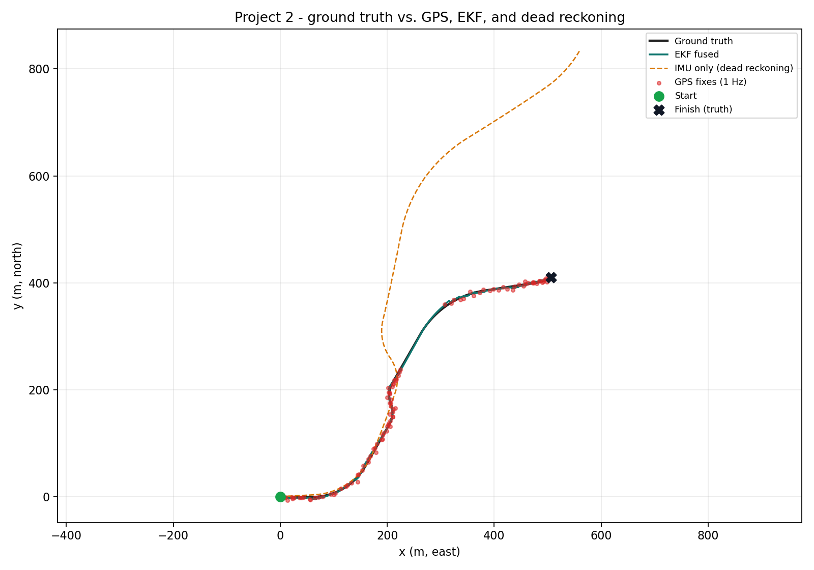
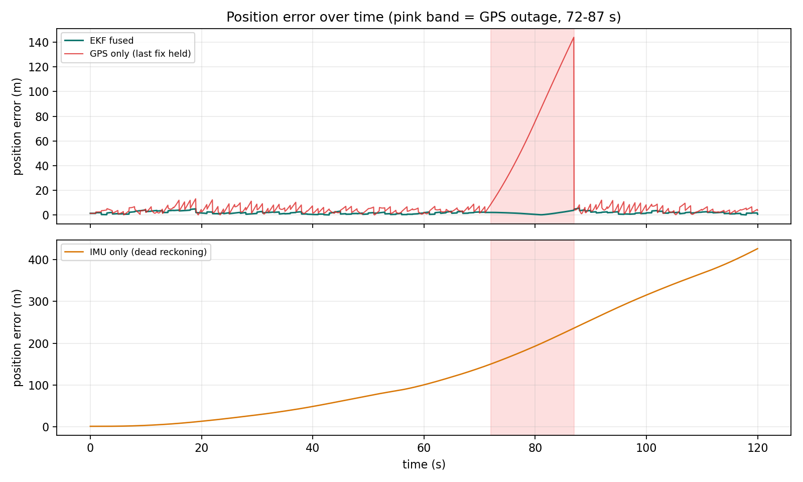
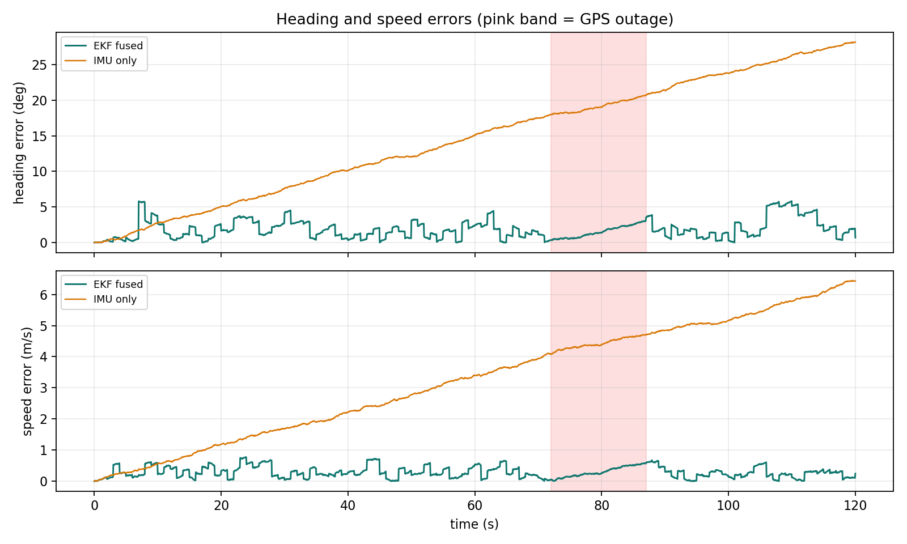

# EKF Sensor Fusion — IMU + GPS

An extended Kalman filter (EKF) that fuses high-rate IMU measurements with low-rate, noisy GPS fixes to estimate a moving platform's position, velocity, and heading - and quantifies exactly how much better fusion is than either sensor on its own.

This is Project 2 of a three-part robotics portfolio. Project 1 (detection + tracking) used a *linear* Kalman filter to predict where image detections would move next. This project takes the honest next step: a **nonlinear** motion model, an EKF with analytic Jacobians, and two new sensor types with opposite failure modes.



## Results (synthetic data, seed 42)

One scripted 120-second trip at 20 Hz — acceleration, braking, left and right turns, and an S-turn — with a **15-second GPS outage** (72–87 s) in the middle:

| Estimator | Position RMSE | Final position error |
|---|---:|---:|
| **EKF fusion (IMU + GPS)** | **2.06 m** | **0.65 m** |
| GPS only, raw fixes (at fix times) | 3.45 m | — |
| GPS only, last fix held between fixes | 29.71 m | — |
| IMU only (dead reckoning) | 196.01 m | 425.93 m |

More from `out/metrics.txt`:

- EKF position RMSE is **40.4% lower** than raw GPS noise, **93.1% lower** than held GPS, and **98.9% lower** than dead reckoning.
- During the GPS outage the EKF coasts on the IMU and stays accurate: **1.76 m RMSE, 3.84 m max error** — while held GPS error grows past 140 m as the platform keeps moving.
- EKF heading RMSE **2.27°** vs. dead reckoning's **16.73°**; speed RMSE **0.34 m/s** vs. **3.74 m/s**.
- All numbers are from the seeded synthetic dataset in `data/` and are reproducible with one command (below). This project uses synthetic data by design — see Limitations.



## What the project does

Neither sensor is good enough alone:

- **GPS** gives an absolute position, but only at 1 Hz, with ~2.5 m of noise per axis — and it can disappear entirely (tunnels, parking structures, urban canyons).
- **An IMU** reports acceleration and turn rate at 20 Hz, smoothly and with no outside help — but integrating noisy, biased inertial measurements drifts without bound. In this simulation, dead reckoning ends **426 m** from the true position after two minutes.

The EKF combines them the way production localization systems do:

1. **Predict** with every IMU sample (20 Hz): advance the state through the nonlinear motion model and grow the uncertainty.
2. **Update** with every GPS fix (1 Hz): correct the state toward the measured position, weighted by how much the filter trusts the prediction vs. the measurement (the Kalman gain).
3. **Coast** when GPS disappears: keep predicting on the IMU alone, let the covariance grow honestly, then re-converge when fixes return.

## How it works

### State and motion model

The filter state is:

```text
x = [x, y, vx, vy, heading]
```

in a local east/north plane (metres, m/s, radians). The IMU provides the control inputs for each step: longitudinal acceleration `a` and yaw rate `ω`. One prediction step of length `dt`:

```text
heading' = wrap(heading + ω·dt)
speed'   = speed + a·dt                      (speed = √(vx² + vy²))
vx', vy' = speed' · (cos heading', sin heading')
x', y'   = position + ½ · (velocity + velocity') · dt
```

Because the new velocity depends nonlinearly on heading and speed, the prediction covariance uses the **analytic Jacobian** of this model (`motion_jacobian` in `src/ekf.py`). The test suite checks that Jacobian against central finite differences on multiple states.

### GPS update

GPS measures position directly, so the measurement matrix simply selects `x` and `y` from the state. The update uses the Joseph form for numerical stability, and the measurement variance is the simulator's true value (2.5 m per axis → 6.25 m²) — the filter is not given a flattering noise model.

### The simulated world

`src/simulate.py` generates everything deterministically (seed 42):

| Stream | Rate | Model |
|---|---|---|
| Ground truth | 20 Hz | Scripted route: accelerate 0→8 m/s, turns at up to ±0.09 rad/s, an S-turn, braking to 3 m/s |
| IMU | 20 Hz | True acceleration / yaw rate + constant biases (0.06 m/s², 0.004 rad/s) + white noise (σ 0.15 m/s², 0.010 rad/s) |
| GPS | 1 Hz | True position + Gaussian noise, σ 2.5 m per axis; **no fixes at all from 72–87 s** |

### The baselines (same trip, same data)

- **GPS raw** — each fix compared to truth at its own timestamp. The honest "how noisy is GPS" number: 3.45 m RMSE.
- **GPS hold** — the newest fix, reused until the next one arrives. This is what a GPS-only system actually outputs between fixes, and it is why held GPS collapses during the outage.
- **Dead reckoning** — starts from the same initial estimate as the EKF and integrates the same noisy IMU stream with no corrections, ever. Its 426 m final error is what IMU bias does when nothing bounds it.

## Run it

Requirements: Python 3, NumPy, and Matplotlib.

```bash
pip install -r requirements.txt
python src/run_fusion.py
```

That single command regenerates the dataset, runs all three estimators, prints the metrics table, and rewrites everything under `data/` and `out/`. Use `--seed N` for a different noise realization.

Run the tests (standard-library `unittest`, no extra install):

```bash
python -m unittest discover -s tests -v
```

Six tests: angle wrapping, the analytic Jacobian vs. finite differences (4 states), the rest-state step, the GPS outage window, a noiseless-sensor tracking check, and the seeded end-to-end claim — EKF RMSE must beat both baselines, with outage max error under 5 m.

## Outputs

```text
data/
├── ground_truth.csv   # 20 Hz truth: position, velocity, heading, speed
├── imu.csv            # true vs. measured acceleration and yaw rate
└── gps.csv            # the 106 fixes that exist (outage seconds absent)
out/
├── estimates.csv      # truth + all three estimators at 20 Hz, with errors
├── metrics.json       # every reported number, machine-readable
├── metrics.txt        # the same numbers, human-readable
├── trajectory.png     # truth vs. GPS points vs. EKF vs. dead reckoning
├── position_errors.png
└── state_errors.png   # heading and speed error over time
```



## Repository structure

```text
.
├── README.md
├── requirements.txt
├── src/
│   ├── ekf.py          # motion model, analytic Jacobian, EKF predict/update
│   ├── simulate.py     # scripted trajectory + IMU/GPS simulation
│   └── run_fusion.py   # estimators, baselines, metrics, plots
├── tests/
│   └── test_ekf.py
├── data/               # generated inputs (regenerated by run_fusion.py)
└── out/                # generated results (regenerated by run_fusion.py)
```

## Design choices

### Why synthetic data first?

The project plan allowed one week of building time before a hard ship date, and Project 1's lesson was that waiting on a dataset download can stall everything. A scripted simulation gives known ground truth, a controlled GPS outage, and a fully reproducible benchmark on day one. A public IMU+GPS dataset remains an upgrade path (see below), not a dependency.

### Why not estimate the IMU biases?

Real systems often add bias states to the filter. This project deliberately keeps the five-state model from the plan and absorbs the biases into the process noise instead — simpler to explain, and the outage behavior shows the cost honestly: uncertainty grows while coasting and the first fixes after the outage carry a few metres of transient error (first-5-seconds RMSE 3.54 m) before the filter settles.

### Why compare against "GPS hold" as well as raw GPS?

Raw-fix RMSE flatters GPS: it only scores the sensor at the moments it speaks. A consumer of GPS output needs a position *between* fixes too, and during an outage "between fixes" becomes 15 seconds of driving. Reporting both numbers keeps the comparison honest in both directions.

## Limitations

- **Synthetic data only.** The trajectory, noise, and biases are simulated. Results show the filter works on this model of the world; they are not field performance.
- **Process noise was tuned on this scenario.** A small sweep against the seeded ground truth selected the per-step process noise; the GPS variance was *not* tuned (it is the true value). On real data the tuning would need to be redone from sensor datasheets and logs.
- **2D, flat-earth, no GPS velocity.** The filter works in a local tangent plane and corrects position only. A production version would work in ECEF/geodetic coordinates or add Doppler/velocity measurements.
- **Biases are modelled, not estimated** (see above).
- The trajectory plot's dead-reckoning line is not exaggerated — 426 m of drift in 120 s is the point of the comparison.

## Possible next steps

- Swap the synthetic feed for a public IMU+GPS dataset (the plan's "Path B") and re-tune from real noise characteristics.
- Add accel/gyro bias states to the EKF and measure the outage improvement.
- Add GPS velocity (Doppler) updates and compare heading observability at low speed.
- Port the filter core to C++ (the language on-robot state estimation actually ships in) and wrap it as a ROS 2 node — which is exactly Project 3.

## What this project demonstrates

Nonlinear state estimation done end to end: a nonlinear motion model with a hand-derived, test-verified Jacobian; IMU-driven prediction and GPS correction at different rates; covariance growth and recovery across a sensor outage; two honest baselines instead of a strawman; and a fully seeded, one-command reproduction of every number and plot in this README.
